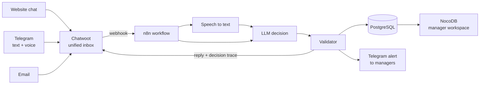

# Omnichannel AI Lead Automation

**From Message to Qualified Lead.** A self-hosted AI system that answers clients across every channel, in their language, by text or voice, and turns each conversation into a structured, scored lead for a manager.

Built for travel agencies, designed for any business that runs on inbound requests.

**▶ [View the presentation](https://lilli-ai.github.io/omnichannel-ai-presentation/)** · **🌐 [Demo agency site: Agentic Trip](https://travel.lilia.am)**

---

## The problem

Requests come from a website chat, Telegram, email and other messengers. Managers answer late, ask every client the same questions, and requests get lost between channels.

## The solution

One pipeline for the full intake cycle: **receive** every message in one inbox, **understand** text or voice, **collect** only the missing details, and **deliver** a qualified lead to the manager. The AI handles intake, the manager handles the sale.

---

## How it works

| Stage | What happens |
|---|---|
| **Intake & security** | Only real client messages pass. Every webhook is verified with an HMAC-SHA256 signature. |
| **AI decision** | The model returns strict JSON: intent, action, priority, language, fields, missing fields, confidence, reason, reply. |
| **Actions** | Validator check, reply to the client, decision trace for the manager, lead saved and scored, urgent cases flagged. |

---

## Key features

- **💬 Omnichannel:** website chat, Telegram and Email in one Chatwoot inbox, one bot, one lead database. A new channel is one more inbox, the AI logic stays the same.
- **🎙️ Voice messages:** clients can speak instead of typing, including in Armenian. The recognized text is visible to the manager.
- **🌍 Multilingual:** Armenian, Russian and English. The bot replies in the client's language and asks to confirm when something is ambiguous.
- **🧠 Explainable decisions:** every decision is saved as a decision trace (what the AI understood, what it did and why), shown to the manager inside the conversation.
- **🛡️ Guardrails:** a validator checks every answer before it reaches the client. Any error ends in a safe handoff to a human. Prompt-injection attempts were tested: the bot stays in its role.
- **📇 Lead scoring:** leads are scored HOT / WARM / COLD and managed in NocoDB by sales stage: new → options sent → thinking → booking → won / lost.
- **🔔 Manager alerts:** a lead card with all details and a direct link to the conversation goes to the managers' Telegram group.
- **🔁 Data integrity:** one open lead per conversation, one trace per message, only valid statuses. No duplicates on repeated webhooks.

## Reliability

| Layer | Primary | Fallback | Last resort |
|---|---|---|---|
| Language model | Groq | OpenRouter (different provider) | Handoff to a manager |
| Speech to text | ElevenLabs Scribe | Groq Whisper | Handoff to a manager |
| Infrastructure | Auto-start after reboot | External uptime monitoring | Email alerts |

Both fallbacks were tested by deliberately breaking the primary service.

---

## Results

Measured on the test dataset from the n8n execution history.

| Metric | Result |
|---|---|
| Median reply time, text | **1.8 s** |
| Median reply time, voice | **3.7 s** |
| Leads with all required fields | **100%** |
| First message to lead | **1.2 min** |
| Duplicate leads | **0** |
| Broken AI answers that reached a client | **0** |
| AI cost per conversation | **$0** |
| Key scenarios passed | **8 of 8** |

---

## Tech stack

| Layer | Technology |
|---|---|
| Conversations | **Chatwoot** (self-hosted) |
| Orchestration | **n8n** (self-hosted) |
| LLM | **Groq** · qwen3.8-27b · backup: **OpenRouter** · Gemma 4 31B, Nemotron 3 Super |
| Speech to text | **ElevenLabs** Scribe v2 · backup: **Groq** Whisper large v3 |
| Database | **PostgreSQL** |
| Manager workspace | **NocoDB** |
| Notifications | **Telegram Bot API** |
| Infrastructure | **Linux VPS, Docker, Nginx, HTTPS** |
| Monitoring | **UptimeRobot** |

---

## Channels

| Live | Ready to connect |
|---|---|
| ✅ Website chat · ✅ Telegram (text and voice) · ✅ Email | WhatsApp, Facebook, Instagram (after Meta verification) · SMS via Twilio · Viber (commercial agreement) |

## Roadmap

CRM integration (Bitrix24, HubSpot) · knowledge base for FAQ (RAG) · approval flow for priced offers · online payment and booking · tour operator APIs · LLM observability (Langfuse) · local model for PII redaction · prompt-injection detection

---

## About this repository

The project presentation: 13 slides with real screenshots of the working system. Plain HTML, CSS and JavaScript, no frameworks. Navigate with arrow keys, buttons or swipe.

## Author

**Lilia Avagyan** · AI Automation and Agentic AI · Yerevan, Armenia
[LinkedIn](https://www.linkedin.com/in/lil-ai-travel) · [GitHub](https://github.com/Lilli-Ai)
